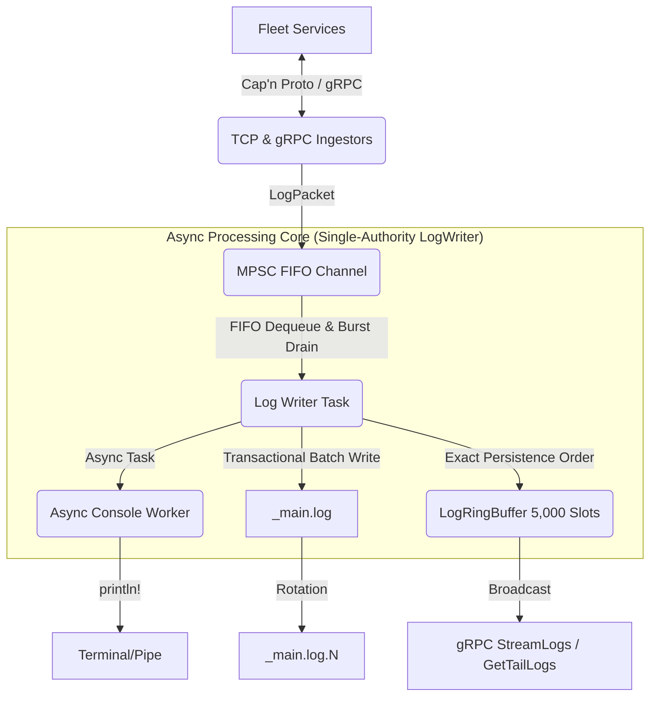

# Log Server Architecture

This document provides a technical deep-dive into the architecture of the `log-server`, a high-performance logging ingestor for the Bastien-Antigravity fleet.

## High-Level Overview

The Log Server is designed as a centralized, non-blocking log ingestion and ordering system. Its primary goals are:
- **Zero Backpressure**: Ingesting logs must not slow down the source microservices.
- **Strict Ordering**: Messages are persisted to disk in the exact sequence they were received.
- **Resource Integrity**: Prevents memory leaks and zombie connections through strict timeouts and buffer management.

## Component Architecture

### 1. Ingestion Layer
The server supports two concurrent protocols for log ingestion:
- **TCP (Cap'n Proto)**: High-performance binary ingestion using packed serialization and Big-Endian length framing.
- **gRPC (Tonic)**: Standardized gateway for environments requiring structured service-to-service communication.

**Key Hardening**: All TCP ingestors implement a 60-second `IdleTimeout` to automatically prune dead connections.

### 2. Networking (`SafeSocket`)
The low-level transport uses a custom wrapper around Tokio's `TcpStream`.
- **Memory Optimization**: Reads frame payloads directly into an exact-sized `BytesMut` buffer without intermediate `Vec<u8>` copies, distinguishing clean 0-byte EOF disconnects from truncated 1..3-byte headers.
- **Frame Validation**: Enforces a `MAX_MESSAGE_SIZE` (10MB) and Big-Endian length prefix validation to prevent OOM attacks.
- **Supervised Client Lifecycle**: `TcpServer::run` tracks all spawned client handlers in a `tokio::task::JoinSet` (and guards per-connection heartbeats via `AbortOnDrop`), ensuring that unified teardown in `LogServer::run` immediately aborts active connections and drops all `writer_tx` handles so `LogWriter` drains cleanly on any exit path.

### 3. Log Writer Task (Single-Authority FIFO Sequencing)
The central orchestrator of the persistence and sequencing layer.
- **Single-Authority FIFO Ordering**: `LogWriter::writer_task` is the sole sequence and serialization authority (`current_sequence: u64`). Producers enqueue `LogPacket` entries into the bounded MPSC channel without pre-channel atomic sequence races, and `writer_task` sequences them in strict FIFO arrival order.
- **Dynamic Burst Batching**: On receiving a packet from `rx.recv()`, `writer_task` drains any immediately available packets via `rx.try_recv()` up to `batch_size`, coalescing high-throughput bursts into a single transactional `write_batch` syscall.
- **Deterministic Shutdown Draining**: Matches `rx.recv()` for `None` explicitly inside `tokio::select!`, breaking out of the event loop when all producers drop and flushing any remaining batch before exit.
- **Non-Blocking Console**: Offloads `println!` operations to a separate async task to prevent slow terminal output from blocking disk persistence or network ingestion.
- **In-Memory Ring Buffer**: Publishes committed entries to the 5,000-slot `LogRingBuffer` immediately after disk batch persistence, guaranteeing identical FIFO ordering between `_main.log` and gRPC `StreamLogs` / `GetTailLogs`.

### 4. Storage & Rotation (`TransactionalFileWriter`)
- **Tier 1 (In-Memory Staging)**: Batches multiple log lines into a contiguous byte buffer before issuing write syscalls, minimizing OS overhead.
- **Tier 2 (Rollback via Checkpointed `ftruncate`)**: Tracks initial byte offset before writes. On partial write errors, rolls file back via `ftruncate` (`file.set_len(checkpoint_offset)`) to drop incomplete records, retrying up to `max_retries`.
- **Tier 3 (Poisoned Handle Recovery)**: If `ftruncate` fails (e.g. broken file descriptor), closes and reopens a clean handle, propagates truncation/seek errors on the fresh descriptor, and verifies `file_size == checkpoint_offset` so an unrecoverable rollback failure is treated as a fatal disk error.
- **Rotation Strategy**: Automatically rotates files when reaching `max_file_bytes` (10MB), cascading across historical files (`.log.0` through `.log.N`).
- **Fail-Fast Lifecycle**: If disk writes permanently fail, emits a structured `[DISK_FAILURE]` `CRITICAL` log into `LogRingBuffer` and aborts the server process with exit code 1, triggering `watchdog-agent`'s crash loop circuit breaker and Telegram alert.

## Data Flow

### Log Ingestion Flow
1. **Source** sends a framed message.
2. **Ingestor** reads length, validates, and deserializes the payload into a `LogEntry`.
3. **Channel** enqueues the `LogPacket` into the bounded MPSC queue in FIFO acceptance order.
4. **LogWriter** dequeues the packet, assigns the authoritative monotonic sequence number, and drains available burst packets up to `batch_size`.
5. **Persistence**: The batch is formatted and transactionally committed to `_main.log` (with size rotation check and flush).
6. **Ring Buffer & Observation**: Committed entries are published to `LogRingBuffer` in exact persistence order and queued for the async console worker.

## Dependencies

- **Tokio**: Multi-threaded async runtime.
- **Cap'n Proto**: High-performance binary serialization.
- **Tonic**: Rust gRPC implementation.
- **Microservice-Toolbox**: Standardized address resolution and bootstrap.
- **Chrono**: High-precision UTC timestamping.
