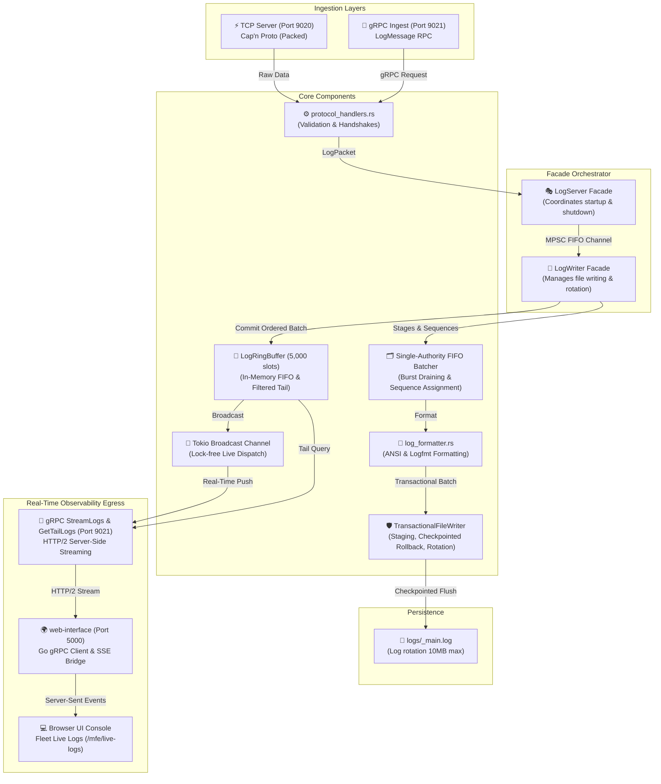

---
tags:
- '#ai/ready'
- '#zone/3-fleet'
- '#service/log-server'
- '#type/architecture-overview'
- '#state/active'
- '#ai/ignore'
microservice: log-server
type: architecture-overview
status: active
---
# 🦀 Log Server: Architecture Overview

Welcome to the **Log Server Architecture Guide**. The `log-server` is a high-performance observability sink written in Rust (v1.88+) designed to ingest, sequence, and write logs from the entire Bastien-Antigravity fleet.

---

## 🏗️ 1. Core Structural Layout

The codebase utilizes a clean **Facade Pattern** to isolate high-throughput networking from underlying file writing and ordering mechanics:



* **Ingestion Layers**: Safe, isolated network tasks running on Tokio green threads.
* **Facade Layers**: High-level managers implementing safe resource management and lifecycle monitoring.
* **Core Logic**: Functional, zero-allocation algorithms for data transformation, single-authority FIFO sequencing, and transactional persistence.

---

## ⚡ 2. The Ingest Pipeline & Threading Mechanics

To ensure deterministic FIFO logging without pre-channel task-yield ordering races, the `log-server` decouples networking threads from disk I/O using a thread-safe **MPSC (Multi-Producer, Single-Consumer) queue** where `LogWriter` acts as the single sequence and persistence authority:

```
[TCP Client 1]  ---\
[TCP Client 2]  ------>  [ MPSC Queue (Capacity: 2048) ]  -->  [ LogWriter (Single-Authority FIFO Task) ]
[gRPC Client 3] ---/                                                  |
                                                                      +---> [ TransactionalFileWriter ] ---> [ logs/_main.log ]
                                                                      |
                                                                      +---> [ LogRingBuffer (5000) ] (Identical Persistence Order)
                                                                                  |
                                                                                  v (Broadcast Channel)
                                                                            [ gRPC StreamLogs :9021 ]
                                                                                  |
                                                                                  v (HTTP/2 Stream)
                                                                            [ web-interface :5000 ]
                                                                                  |
                                                                                  v (Server-Sent Events)
                                                                            [ Browser UI Console ]
```

1. **Network Handlers (Producers)**:
   * Each raw TCP connection is allocated a separate Tokio task spawning a `SafeSocket` framer.
   * It performs the **Mandatory Handshake (`HelloMsg`)**, validates packet size, and deserializes the Cap'n Proto payload.
   * It packages the log into a `LogPacket` and sends it down the `mpsc::Sender` FIFO channel.
2. **LogWriter (Single-Authority Consumer)**:
   * A single background worker `writer_task` owns the `mpsc::Receiver` and the authoritative monotonic `current_sequence: u64`.
   * Upon receiving a packet from `rx.recv()`, it drains any immediately available burst packets via `rx.try_recv()` up to `batch_size`.
   * It flushes the batch transactionally to `_main.log` via `TransactionalFileWriter` with checkpointed `ftruncate` rollback, checks for size-based rotation, and then commits the entries into `LogRingBuffer` in exact persistence order.
3. **Real-Time Streaming Egress**:
   * `web-interface` connects as a gRPC client to `log-server:9021` invoking `StreamLogs`.
   * The browser opens an EventSource connection to `/api/v1/system/logs/stream`.
   * Incoming log events are pushed down the pipe in sub-millisecond real time.

---

## 🛡️ 3. Safety Controls

* **Slow-Loris Guard**: The TCP server enforces a strict **5-second timeout** on incoming handshakes. Non-compliant connections are instantly severed to prevent exhaustion.
* **Dynamic Backpressure**: If the MPSC buffer hits 2048 messages (e.g., due to disk I/O bottlenecks), network producers yield asynchronously to preserve memory safety.
* **Transactional Disk Integrity**: Checkpointed `ftruncate` rollback drops corrupt partial write records if write syscalls fail.
* **Fail-Fast Fleet Supervision**: When disk writes exhaust retries, `writer_task` records `[DISK_FAILURE]` `CRITICAL` (level 11) in `LogRingBuffer` and aborts the server with exit code 1. `watchdog-agent` intercepts the crash and activates its crash loop circuit breaker.
* **Decoupled Failure Domains**: An ingestion crash on a single gRPC or TCP socket never halts the file writing engine or blocks other clients.
