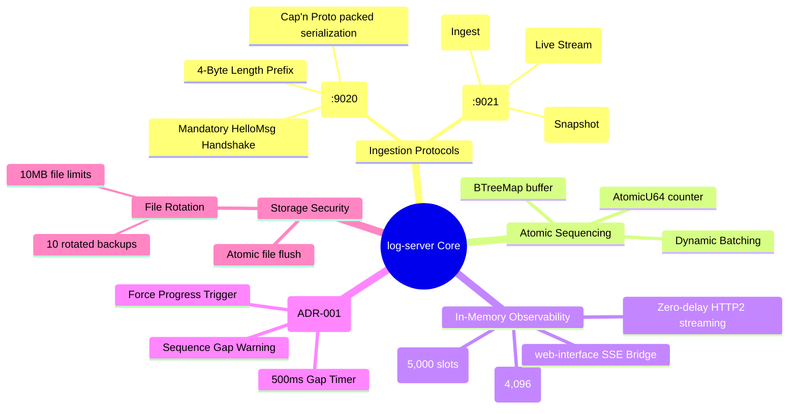

---
tags:
- '#ai/ignore'
- '#zone/3-fleet'
- '#service/log-server'
- '#type/features-behavior'
- '#state/active'
microservice: log-server
type: features-behavior
status: active
---
# 🧠 Log Server: Features & Behavior

This document describes the runtime behaviors and features implemented by the `log-server` microservice to guarantee reliable, ordered log ingestion under real-world network conditions.

---

## 🗺️ Functional Breakdown

---

## 🎯 Key Behaviors

### 1. Hardened TCP Ingestion & Handshakes
*   **Protocol Details**: Runs on Port **`9020`**. Enforces a **4-byte Big-Endian length prefix** on every message payload.
*   **Mandatory Handshake**: Upon connection, a client MUST immediately send a standard Cap'n Proto `HelloMsg` specifying its identity (e.g. `mt5-gateway`).
*   **Handshake Timeout**: If no valid handshake is completed within **5 seconds**, the connection is aborted. Skipping handshakes or sending malformed data results in an immediate connection drop.

### 2. gRPC Log Bridge (Port `9021`)
*   Provides a high-throughput Tonic-based gRPC service (`logservice.LogBridge`) supporting:
    1.  `rpc LogMessage(LogRequest) returns (LogResponse)`: Structured message ingestion mapped into internal `LogEntry`.
    2.  `rpc GetTailLogs(TailLogsRequest) returns (TailLogsResponse)`: Historical query returning recent buffered logs with optional service and level filters.
    3.  `rpc StreamLogs(StreamLogsRequest) returns (stream LogRequest)`: Real-time server-side streaming over HTTP/2.

### 3. In-Memory Circular Buffer & Real-Time Streaming Egress
*   **Ring Buffer (`LogRingBuffer`)**: Retains the last 5,000 log entries in memory using a thread-safe `RwLock<VecDeque<LogEntry>>` with $O(1)$ FIFO wrap-around.
*   **Tokio Broadcast**: An asynchronous `broadcast::Sender<LogEntry>` (4,096 capacity) broadcasts every received log immediately upon ingestion.
*   **Zero-Polling Pipeline**: When `web-interface` connects via `StreamLogs`, logs are pushed down an active HTTP/2 stream with sub-millisecond latency and forwarded to the browser via Server-Sent Events (`/api/v1/system/logs/stream`).

### 4. Single-Authority FIFO Sequencing & Burst Batching
*   To eliminate artificial sequence gaps caused by Tokio task yields between atomic increment and channel enqueue, `LogWriter::writer_task` is the **single serialization and sequence authority**:
    1.  Producers enqueue `LogPacket` messages directly into the MPSC FIFO channel.
    2.  `writer_task` assigns monotonic `u64` sequence numbers in strict channel dequeue order.
    3.  Burst packets immediately available in the channel are drained via `rx.try_recv()` up to `batch_size`, written transactionally to `_main.log`, and committed to `LogRingBuffer` in exact persistence order.
    4.  When all producer channels close (`rx.recv()` returns `None`), `writer_task` drains and flushes any remaining batch and exits cleanly.
